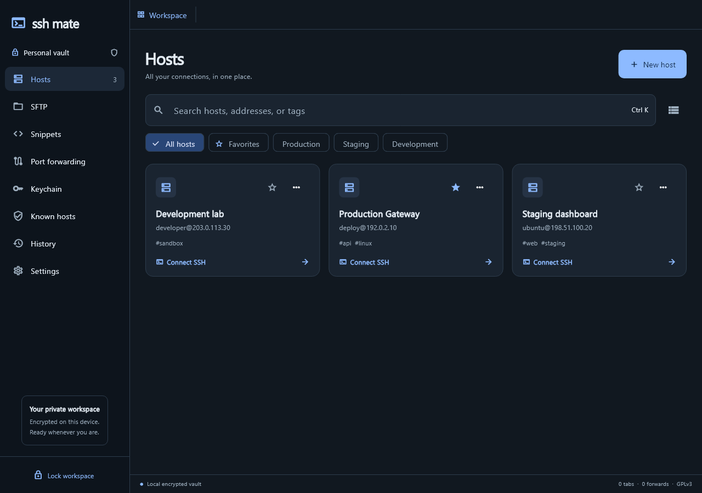
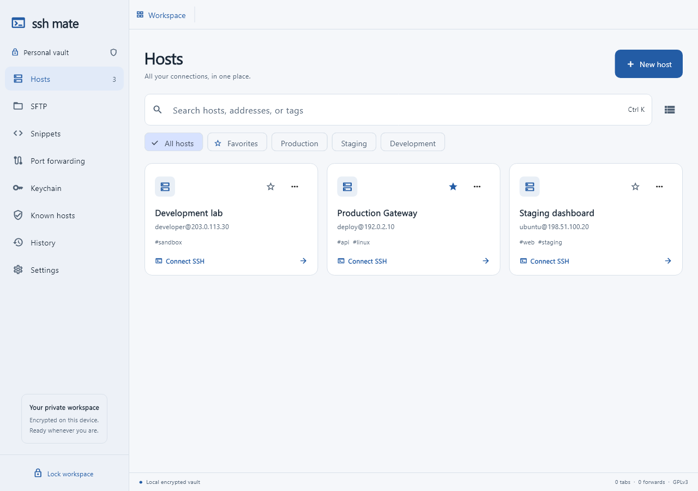

# SSH Mate

**A private, offline first SSH workspace for Windows.** SSH Mate brings server management, encrypted local credentials, interactive terminals, SFTP and port forwarding into one open source Flutter desktop app.

[](https://github.com/enclave-projects/ssh-mate-desktop/actions/workflows/windows.yml)
[](LICENSE)

SSH Mate is built for people who want a practical SSH workspace without a required vendor account, subscription, telemetry or hosted service. It works with user-selected SSH servers and stores its workspace in a password-protected local vault. It is an independent project and is not affiliated with Termius.

> **Project status:** Early release (0.2.0). The core Windows workflow is implemented and tested. SSH Mate does not yet match every feature in established SSH clients. Review the [roadmap](docs/ROADMAP.md) and [security model](docs/SECURITY.md) before relying on it for sensitive production work.

## What you can do

- Organize SSH hosts with groups, tags, favorites, search and notes.
- Open interactive, resizable terminals in separate session tabs.
- Save passwords and private keys in an encrypted local vault, or enter a password for one session.
- Browse remote files and upload, download, rename and remove files and directories over SFTP.
- Forward local loopback ports through independent SSH connections.
- Save command snippets, verify server fingerprints and keep a bounded local connection history.
- Export encrypted backups, restore or import a workspace, change the vault password and preview supported OpenSSH host entries.
- Choose dark or light appearance and keep separate vaults in isolated folders.

The vault uses AES-256-GCM with PBKDF2-HMAC-SHA256 (600,000 iterations). This describes local encryption at rest; it is not an audited end-to-end sync system. SSH Mate has no cloud sync service. See [SECURITY.md](docs/SECURITY.md) for the threat model and limitations.

## Preview

| Dark workspace | Light workspace |
| --- | --- |
|  |  |

The previews use disposable test hosts and contain no account data or credentials.

## Get started

Download a Windows build from [GitHub Releases](https://github.com/enclave-projects/ssh-mate-desktop/releases) when one is published, or [build from source](#build-from-source). Release artifacts should be downloaded only from this project’s official releases page.

On first launch, create a vault password with at least 12 characters. Add a host, then add or select an identity in **Keychain**. If no identity is assigned, SSH Mate asks for an SSH password for that session. Verify a first-use server fingerprint with an independent trusted source before accepting it.

There is no password recovery service. Keep the vault password and encrypted backups safe. Existing backup files keep the password that protected them at export time.

## Build from source

Windows development requires Flutter with Dart 3.13.4 or compatible and the Visual Studio C++ desktop toolchain.

```powershell
flutter pub get
flutter run -d windows
```

The application does not require a network service to run. Initial dependency resolution and updates require internet access.

## Verify changes

Install Python 3 and the disposable SSH fixture dependency, then run:

```powershell
python -m pip install -r test/fixtures/requirements.txt
flutter analyze
flutter test
flutter test integration_test/ssh_mate_e2e_test.dart -d windows --dart-define=SSH_MATE_REPO=$PWD
flutter build windows --release
```

Tests use temporary vault folders and generated credentials against a loopback-only SSH/SFTP server. They do not contact production servers. GitHub Actions runs the analysis, test suite and Windows build on pushes and pull requests.

## Project guide

- [Contributing](CONTRIBUTING.md) explains setup, checks and pull requests.
- [Repository guidelines](AGENTS.md) describes project structure and style.
- [Security model](docs/SECURITY.md) documents storage, SSH trust and known limits.
- [Roadmap](docs/ROADMAP.md) lists implemented and planned features.
- [Research notes](docs/RESEARCH.md) records the bounded product research behind the first release.
- [Workbench design system](docs/design/DESIGN_SYSTEM.md) defines UI foundations and interaction patterns.

Windows release files are produced in `build/windows/x64/runner/Release/`. Distribute the complete folder, including its DLLs and `data` directory, with the GPLv3 license and relevant third-party notices.

## License

SSH Mate is free software licensed under the GNU General Public License, version 3 only. See [LICENSE](LICENSE). Third-party components retain their respective licenses; xterm.dart’s MIT license and local compatibility patch are documented in [`third_party/xterm`](third_party/xterm/SSH_MATE_PATCHES.md).
